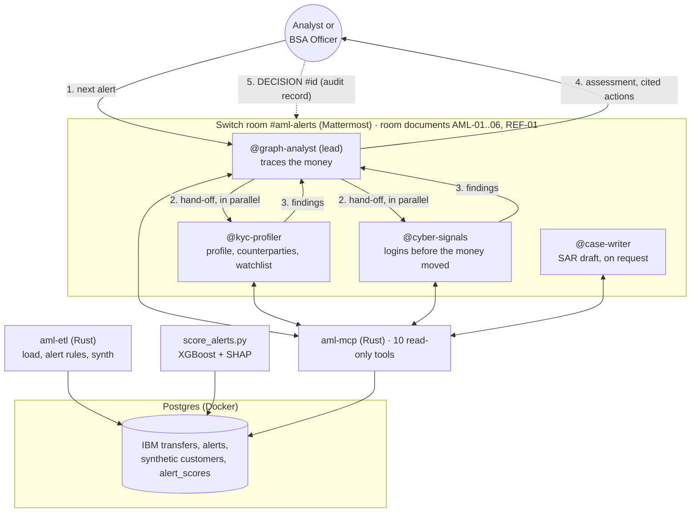

# Chakshu

**AI investigators for anti-money-laundering alerts, working inside your team's chat.**

Chakshu (चक्षु, "eye" in Sanskrit) is a Switch room where AI agents investigate each
money-laundering alert in parallel and hand a person an explained, sourced
recommendation. The agents investigate; the humans decide.

Built for the Flip the Switch hackathon (Track 01: Best Business Workflow).

> Prototype on synthetic data. Not legal or compliance advice.

## The problem

Banks must report suspicious activity, but their rule-based monitoring raises so many
false alarms that analysts spend most of the day closing noise, while real laundering
hides in the pile.

## Agents we connected

Four Claude Code agents, created and run by Switch Console from one template
([`switch/chakshu-room.template.yaml`](switch/chakshu-room.template.yaml)). They reach
bank data only through Chakshu's read-only MCP server, written in Rust.

| Agent | Runs on | Job |
|---|---|---|
| `@graph-analyst` | Claude Code (Sonnet) | Lead investigator: takes the next alert, traces the money (fan-in, fan-out, pass-through, loops), hands off to the specialists, then posts a risk assessment with sourced recommendations |
| `@kyc-profiler` | Claude Code (Sonnet) | Compares the account's activity with the customer's profile, checks how new the counterparties are, screens the watchlist |
| `@cyber-signals` | Claude Code (Sonnet) | Checks logins, devices and password resets before the money moved, to tell a takeover victim from a launderer |
| `@case-writer` | Claude Code (Sonnet) | Drafts the SAR narrative, only when a person asks |

## How the channel is set up

One private Mattermost channel, `#aml-alerts`, created by the template with the four agents
and you in it.

- **Room instructions** tell every agent the workflow and the rules: investigate and
  recommend, never decide; cite a room document for every recommendation; compute
  deadlines only with the `sar_deadline` tool; never suggest telling the customer
  about an investigation.
- **Room documents** hold the bank's rulebook: six policies of a fictional bank (AML-01
  to AML-06) and a summary of public US guidance (REF-01), from
  [`knowledge/policies/`](knowledge/policies/). Agents cite them by ID.
- **The flow:** a person asks `@graph-analyst` for the next alert. It traces the money and
  hands off to `@kyc-profiler` and `@cyber-signals`, who investigate **in parallel** and
  each reply by tagging `@graph-analyst` (in Switch, an agent's message wakes another agent
  only when it names it). Once both are in, `@graph-analyst` posts the assessment, with the
  ML risk score as one signal among the evidence. **A person decides**, in one
  line: `DECISION #<alert id>: CLOSE | ESCALATE | FILE SAR | NO SAR | REFER FRAUD - <reason>`.
  The room's history is the case file and audit trail.
- Agents answer only their owner and each other (`addressing: owner-agents`).

## How to run it

### Prerequisites

- Docker Desktop
- Rust 1.85 or newer
- Python 3.11 or newer
- Switch Console, with a local server running
- At least one agent CLI: Claude Code, Codex or OpenCode

### Steps

On Windows, in PowerShell, from the repository folder:

```powershell
copy .env.example .env          # then set POSTGRES_PASSWORD, and the same password in DATABASE_URL
docker compose up -d            # starts Chakshu's database on localhost:5433
cargo build --release
```

Download the three IBM data files into `data/raw/` (see [`data/README.md`](data/README.md)),
then load them. The full load of about 5 million transfers takes a few minutes:

```powershell
cargo run --release -p aml-etl -- load --data-dir data/raw
```

Run the bank-style alert rules, then generate the synthetic customer data:

```powershell
cargo run --release -p aml-etl -- alerts
cargo run --release -p aml-etl -- synth
```

`alerts` prints how many alerts each rule raised and how many were real laundering.
Its thresholds can be changed, for example `-- alerts --fan-min 6 --min-usd 50000`
(see `-- alerts --help`).

Train the risk model and score every alert (a few minutes on the full data):

```powershell
python -m pip install -r python/requirements.txt
python python/score_alerts.py
```

It prints the model's results and writes a score with its top three reasons for each
alert to the `alert_scores` table, which the `score_alert` tool reads.

### Start the MCP server

The agents reach the bank data only through Chakshu's read-only MCP server. Leave it
running in its own PowerShell window:

```powershell
cargo run --release -p aml-mcp      # serves http://127.0.0.1:8090/mcp
```

Switch does not pass your own Claude Code MCP settings to the agents it starts, so each
agent's folder carries its own connection to this server (`.mcp.json`), written by
`scripts/setup-agent-folders.ps1` in the next section.

| Tool | What it returns |
|---|---|
| `list_alerts` | Alerts from the rules engine, newest first (filter by rule or day) |
| `get_alert` | One alert: account, day, rules fired, money in and out, the customer |
| `get_transactions` | The account's transfers that day, in original currency and USD |
| `get_counterparties` | Who it paid and was paid by, with each counterparty's account age |
| `get_customer_profile` | What the bank recorded at onboarding vs. what the account actually moved |
| `get_login_events` | Logins and password resets, flagging new devices and foreign countries |
| `screen_watchlist` | Fuzzy name screening against the fictional watchlist |
| `detect_patterns` | Fan-in, fan-out, pass-through, and short loops through the account |
| `score_alert` | The ML risk score (HIGH, UNSURE or LOW) and the top three reasons behind it |
| `sar_deadline` | The SAR filing deadline under 31 CFR 1020.320 (30 days, or 60 with no suspect) |

Every tool only reads. None can close a case, file a report or contact a customer, and
none returns IBM's ground-truth labels (a test fails the build if the server's code
mentions them).

### Create the room

1. Prepare the agents' folders (each gets the connection to the MCP server):
   ```powershell
   powershell -ExecutionPolicy Bypass -File scripts\setup-agent-folders.ps1
   ```
   It prints the agents' folder, for example `C:\Users\you\chakshu-agents`.
2. Save `switch/chakshu-room.template.yaml` under **Templates** in Switch Console. On
   Windows, Console cannot start agents itself, so ask **switch-buddy** to run it: "Run my
   template Chakshu room with Claude Code on my computer, agents_root =
   C:\Users\you\chakshu-agents". Switch creates the four agents and `#aml-alerts`.
3. With the MCP server running, type in `#aml-alerts`:
   ```
   @graph-analyst next alert
   ```

   The agents investigate; you reply with a `DECISION #<id>: ...` line.
4. Optional: `python python/demo_candidates.py` lists clear example alerts of each kind
   (mule, takeover victim, watchlist near-match, safe to close, unsure).

## Architecture



| Part | Language | Path | Job |
|---|---|---|---|
| Data pipeline | Rust (csv + Postgres COPY) | `crates/aml-etl` | Loads IBM's files, runs four bank-style alert rules, generates the synthetic customer data (SQL in `db/`) |
| Graph patterns | Rust (petgraph) | `crates/aml-graph` | Fan-in, fan-out, pass-through ratio, short loops through an account |
| MCP server | Rust (rmcp, streamable HTTP) | `crates/aml-mcp` | The only way agents reach bank data. Read-only; never returns ground-truth labels |
| Risk model | Python (XGBoost) | `python/score_alerts.py` | Out-of-fold risk score per alert, with the top three SHAP reasons |
| Room | YAML | `switch/` | Switch template: four agents, the private room, its instructions and documents |
| Policies | Markdown | `knowledge/policies/` | The fictional bank's rulebook that agents cite |

**Why it is built this way**

- **People decide, in the room.** No tool can close a case, file a SAR or contact a
  customer. Agents end with "Decision needed", and the decision line a person types is the
  audit record.
- **Every recommendation cites its source**, a room document by ID and section, so a
  reviewer can check it.
- **Deadlines come from code.** The SAR deadline (31 CFR 1020.320: 30 days from detection,
  at most 60 with no suspect) is computed by the `sar_deadline` tool, never by a model.
- **The agents never see the answers.** IBM's labels are used only to train and evaluate
  the model; a test fails the build if the MCP server's code mentions them.

## Results

### The risk model

XGBoost on every alert, 5-fold cross-validation. Each alert's score comes from a model
that did not see that alert. Results are reported for two feature sets, because the
customer data is synthetic, with signals we planted on real cases (see
[`data/README.md`](data/README.md)): the first row is the honest one.

The full run covers 46,126 alerts, of which 723 (1.6%) are real laundering. An analyst
working the rules' queue in order would find 1 real case in about every 64 alerts.

| Features | ROC-AUC | PR-AUC | Real cases in the top 100 alerts | Real laundering caught in the top 10% | in the top 20% |
|---|---|---|---|---|---|
| Rules alone (queue in random order) | 0.50 | 0.016 | about 2 | 10% | 20% |
| IBM transactions only | 0.929 | 0.422 | 86 | 82% | 90% |
| Transactions + synthetic customer data | 0.953 | 0.609 | 99 | 88% | 93% |

In plain words: sorted by the model's score, the first tenth of the queue holds 82% of
the real laundering, using IBM's transaction data alone. The agents see each alert's
score and its top three reasons through `score_alert`, and weigh it as one signal.

### Two cases from the live room

- **Alert #30007, unexplained volume.** A 74-day-old "grocery" partnership moved 80 times
  its expected monthly activity. No takeover signals, no watchlist match. The agents
  recommended escalation, citing AML-01 s3 and AML-04 s2, and said plainly that they
  could not see the owners. The analyst decided `ESCALATE`.
- **Alert #44584, a takeover victim.** A password reset and a new-device login from the US
  on an Australian clinic's account, 4 hours before $47,563 fanned out to 5 accounts, 3 of
  them under 90 days old. The agents read it as a likely victim, not a launderer, and
  recommended a same-day fraud referral (AML-03 s2). The analyst decided `REFER FRAUD`.

## Limits

- All data is synthetic: IBM's simulated transfers plus customer data we generated.
  The customer signals were planted, so the agents' job is easier than in a real bank.
- The four alert rules catch only part of the laundering in the data; they are a simple
  stand-in for a bank's monitoring system.
- Owners and beneficial owners are not in the data, and the agents say so.
- Prototype only: not legal or compliance advice.

## Next steps

- **Alert feed:** post each new alert into the room automatically, and remind the room as
  a SAR deadline approaches, so nobody has to ask for the next alert.
- **Real owner data:** add beneficial owners, so the watchlist screen covers the people
  behind a company, not only its name.
- **Learning from decisions:** feed the analysts' DECISION lines back into the model.

## Data

All data is synthetic. Transactions come from IBM's synthetic AML dataset (Altman et al.,
NeurIPS 2023), used under the CDLA-Sharing-1.0 license and not redistributed here.
See [`data/README.md`](data/README.md).

## License

MIT. See [`LICENSE`](LICENSE).
